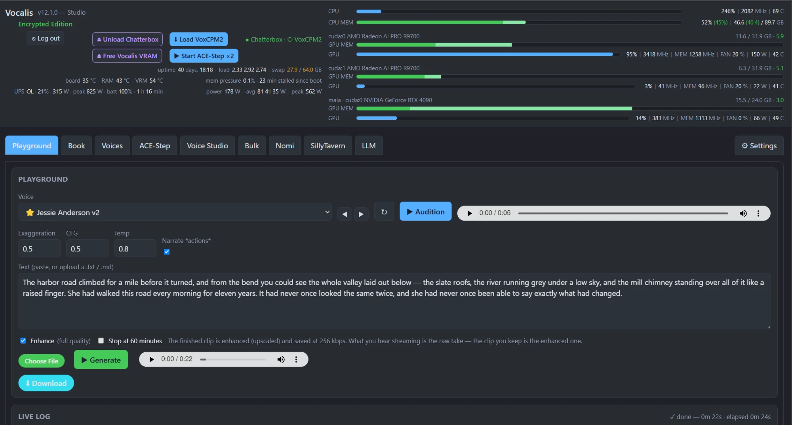

Vocalis is a self-hosted voice, audiobook and music studio that runs on your own graphics card. It comes with its own AI chat front end: a fork of [SillyTavern](https://github.com/SillyTavern/SillyTavern) that keeps your chats, characters and memories encrypted at rest. What you create and keep in Vocalis is encrypted at rest too: your voices, audiobooks, saved music and world books. Speech, audiobooks and music are all made on your own machine; nothing goes to a cloud service unless you choose a hosted model provider for chat.

## What you can do with it

- **Install it with one program.** A setup program on Windows, one script on Linux. Everything runs in two Docker containers, so there is no Python or Node environment to build. Validated on **Windows 11** (NVIDIA) and **Ubuntu 26.04 LTS** (AMD). Linux with an NVIDIA card uses the same image as Windows and should work too, but has not been tested yet.
- **Turn text into speech in any voice you choose.** Type or paste text and hear it within seconds, streamed while the rest is still rendering. Speech is made by [Chatterbox](https://github.com/resemble-ai/chatterbox).
- **Make your own voices.** Clone a voice from a short recording, or describe one in words and have VoxCPM2 create it. Voice Studio cleans up, enhances and trims your recordings first.
- **Turn a book into an audiobook.** Load a `.docx` or `.epub` and render the whole book with one click. You can stop and pick up where you left off, redo any single chapter, and export the whole book as one Opus, MP3 or AAC file.
- **Take a song apart.** Split any song into vocals, drums, bass and the rest, or pull out just the lead singer, without the backing vocals and the room echo.
- **Make music.** A full front end for ACE-Step: describe a song or write the lyrics yourself, queue up takes or let it generate forever, save your presets, and keep the songs you like in a library with favorites.
- **Chat with your AI characters and hear them answer.** [SillyTavern](https://github.com/SillyTavern/SillyTavern) comes installed, with the Vocalis address already filled in; you paste one pairing token and the two are connected. The copy bundled here is a fork named Taproom: it is SillyTavern, with the extensions below already set up. Every message gets a play button that speaks it in that character's own voice, and new replies can be read aloud as they arrive.
- **Keep it private: your data is encrypted at rest.** Vocalis encrypts what you make, on disk: your voices, your books, the audio you generate, your saved songs, and your world books and character cards. The bundled SillyTavern (the Taproom fork) encrypts your chats, characters, world books, memories and settings, file names included. Your password unlocks them when you log in; the few things not covered are listed [below](#privacy-and-encryption).
- **Give your characters a long memory.** Mnemosyne, a SillyTavern extension written for this package, stores what happened in an encrypted vector database with no cap on its size, and brings back what matters on each turn. It comes only with this package and is not published separately; its source is in [`source/mnemosyne`](source/mnemosyne) if you want to take it from here.
- **See why a reply was slow.** CacheLens, a SillyTavern extension, shows how much of each turn's prompt your model's cache could reuse, so you can see what makes a reply slow.
- **Build and edit SillyTavern world books with your LLM.** Create world books, character cards and personas, pull them straight from SillyTavern and save them back, or import and export the standard files. Type one instruction, run it over a whole world book, and approve the changes in a review queue. A rename across 110 entries is one instruction instead of an afternoon.
- **Load and unload your local model from the same page.** Vocalis talks to your llama.cpp or KoboldCpp server, so you can swap between the chat model and speech on one card without leaving the browser. The [setup reference](packaging/README.md) shows how to point it at your server. A local model is not required: you can of course chat with a model in the cloud instead, using the provider API keys SillyTavern already supports. The world book editor can also use OpenRouter or Featherless.
- **Hear your Nomi in a voice you made.** Nomi.ai has its own stock voices, and you can pay for ElevenLabs. Vocalis gives you a third choice: a Chrome extension that adds a play button to every Nomi message and speaks it in a Chatterbox voice of your own, made from any recording of 10 seconds to a minute, with a different voice for each Nomi. It runs on your own machine, and Chatterbox needs only about 5 GB of card memory to do it.
- **Rather use your own SillyTavern?** If you would rather use a SillyTavern you already run than the one bundled here (the Taproom fork, which encrypts your characters, world books and memories at rest), you can set up the Vocalis narration extension in it by hand. Its [README](source/vocalis/sillytavern/README.md) has the steps.
- **Fix up audio in bulk.** Clean up or enhance a pile of files in one pass and get them back as a single ZIP.
- **Borrow a second computer's graphics card.** A render satellite lends another machine's card to Vocalis for speech and for faster audiobooks. Tick any mix of your own cards and satellites in Settings, and Vocalis uses all of them at once. See [below](#optional-render-satellites).
- **Give chats tools.** The MCP client lets your SillyTavern chats use tools from the MCP servers you add (servers reached over HTTP; this build does not start local stdio servers).
- **Watch your hardware.** The header shows card memory, load, temperatures and power as you work, and your UPS if it reports through a NUT server.



*The Playground. This is the dark theme; there is a light theme too.*

The bundled SillyTavern (the Taproom fork) and its extensions come installed and switched on. For chat you supply your own model: a local llama.cpp or KoboldCpp server, or a hosted provider and its API key.

## What you need

| | Linux | Windows 10 or 11 |
| --- | --- | --- |
| Graphics card | NVIDIA, or an AMD Radeon RX 9000 series or Radeon AI PRO R9000 card | NVIDIA |
| Docker | Docker Engine with Compose v2 | Docker Desktop with WSL 2 |
| Card access for Docker | NVIDIA: the NVIDIA Container Toolkit. AMD: a working ROCm-capable driver. | A current NVIDIA driver; Docker Desktop does the rest. |
| Disk | About 75 GB for the images in Docker's storage, and about 64 GB for models in the data folder | The same |

Setup checks these and tells you what is missing. It never installs Docker, drivers or WSL for you.

How much card memory each part needs, free, at the time you use it:

| What | Free card memory |
| --- | --- |
| Speech (Chatterbox) | About 5 GB |
| Music, the fast model (`acestep-v15-turbo`) | About 11 GB on NVIDIA, about 14 GB on AMD |
| Music, the two large models (`acestep-v15-xl-sft`, `acestep-v15-xl-base`) | About 17 GB for a song; about 22 GB for Extract, Replace and Complete |

These are measured on a 24 GB NVIDIA card and a 32 GB AMD card. What counts is free memory, not the card's size: the desktop, a browser, a game or the speech model on the same card all take their share first. If the card is too full, a music render becomes very slow or the music engine refuses it. To make room, unload the speech model on that card or close other programs that use it. On cards under 20 GB the music engine switches to a slower low-memory mode by itself; the large models are not tested there.

An AMD card on Windows is not supported, because Docker Desktop cannot give an AMD card to a container. Linux is fully tested with an AMD card. The AMD image supports one AMD card family: the Radeon RX 9000 series and the Radeon AI PRO R9000 series (RDNA 4). It is tested on the Radeon AI PRO R9700; other AMD cards will not work with it. Linux with an NVIDIA card uses the same image as Windows and should work, but has not been tested yet.

One installation is for one user. If several users need this, each one installs their own copy, with its own folder and ports.

## Install

### Windows

1. Download `Vocalis-Setup-<version>-x64.exe` from the [Releases](../../releases) page and run it. It needs no administrator rights.
2. The setup program checks Docker Desktop, WSL and the NVIDIA card, then asks for a data folder and two ports. The defaults are fine for most users.
3. A console window opens for the long part: it pulls the images, downloads the models, and asks you to choose a password for the owner account of Taproom, the bundled SillyTavern.
4. When it finishes, the last page links to Vocalis and Taproom.

The Start menu gets **Vocalis**, **Taproom**, **Start Vocalis**, **Stop Vocalis** and **Repair setup**. If the download or setup is interrupted, **Repair setup** carries on from where it stopped.

### Linux

1. Download the release's source archive from the [Releases](../../releases) page and unpack it.
2. Run setup with the card type and the two image references listed in the release notes. For an AMD card, which is the tested setup on Linux:

```sh
packaging/setup.sh --variant rocm \
  --vocalis-image <Vocalis AMD image reference> \
  --taproom-image <Taproom image reference>
```

For an NVIDIA card use `--variant cuda` and the Vocalis NVIDIA image reference instead; that combination should work on Linux but has not been tested yet. Setup asks where to keep the data (default `~/.local/share/vocalis/instance`), pulls the images, downloads the models, and asks you to choose a password for the Taproom owner account. Running the same command again carries on after an interruption.

### First start

Vocalis is at `http://127.0.0.1:18770` and Taproom at `http://127.0.0.1:18771` unless you chose other ports.

These are plain `http` addresses that answer only on this computer. If you want HTTPS, or want to reach them from another device, we recommend installing a reverse proxy such as [Caddy](https://github.com/caddyserver/caddy) in front of them. It handles the certificates for you, and nothing in Vocalis or Taproom has to change. The [setup reference](packaging/README.md) has the details.

1. Open Vocalis. The first visit takes you to its setup page, where you create your login and its encrypted store. **Write down the recovery key it shows.** It is the only way back in if you forget the password.
2. Open Taproom and log in with the owner password you chose during setup. Your first login creates its encrypted store and shows a recovery key in a popup; keep that one too.
3. Pair the two: in Vocalis Settings, copy the pairing token from the SillyTavern section, and paste it into the Vocalis extension's settings in Taproom. Send a short message to hear it narrated.
4. In Taproom, add your chat provider, model and API key. For a model server running on this same computer, give its address as `http://host.docker.internal:<port>`, not `127.0.0.1`: inside a container, `127.0.0.1` is the container itself. The server also has to listen on more than the loopback address.

## Models

Setup downloads the public model files (Chatterbox, VoxCPM2, Resemble Enhance, the trim scorer, the three ACE-Step music models, DeepFilterNet3, HTDemucs for stems and the lead-vocal models) from their publishers, about 62.5 GB in all, and checks every file. Vocalis downloads nothing later while you work. The exception is on the Taproom side: the first time Taproom starts, it downloads Mnemosyne's small embedding model (about 110 MB), and SillyTavern's own optional local features fetch their models the first time you use them. A rerun downloads only what is missing, and model files already on the computer from another Vocalis installation are copied instead of downloaded again.

## Where your data lives

Everything you make is in one data folder outside Docker, so it survives updates and reinstalls.

| Folder | What is in it |
| --- | --- |
| `data/vocalis` | Your login, settings, voices, books, generated audio and music. |
| `data/taproom` | Taproom's configuration, accounts, chats and memories. |
| `models/vocalis` | The downloaded model files. |
| `cache/vocalis` | Render caches. |
| `work/vocalis` | Working files: uploads being prepared, bulk jobs, voice candidates, and the music engine's generated songs. |
| `logs` | Logs for the two services. |

Default location: `%LOCALAPPDATA%\VocalisDocker\instance` on Windows, `~/.local/share/vocalis/instance` on Linux. To back up, stop the services and copy the folder; `models` can be left out, because setup can download it again.

## Privacy and encryption

Your voices, books, generated audio, chats and memories are stored encrypted, and unlocked with your password when you log in. Three things are not covered:

- Files in `work` are not encrypted. Most are there only while a job runs. Two kinds stay longer. A generated song is a plain audio file for as long as it is in the ACE-Step tab's candidates tray, or can still be brought back with Undo; it is deleted once you discard it for good (the next discard replaces what Undo can bring back), and songs older than the 60 the tray remembers go the first time you open the ACE-Step tab after Vocalis is next started (saving a song to the library stores a separate, encrypted copy). And Bulk keeps the files you staged until you remove them, and the last finished batch of each mode until you clear it, run the next batch of that mode, or it is a week old when Vocalis starts.
- Model files and ordinary logs are not encrypted. Logs do not contain passwords, keys or pairing tokens, and Taproom's log does not contain your conversations.
- Taproom's list of MCP servers (`data/taproom/mcp-servers.json`) is a plain file. If a server needs a secret such as an authorization header, that secret is stored there unencrypted.

If you want those encrypted as well, keep the data folder on encrypted storage. That part is yours to set up:

- **Linux:** we recommend [eCryptfs](https://www.ecryptfs.org/). Choose a data folder inside an eCryptfs directory when setup asks, or leave the data folder where it is and make its sub-folders (`work/vocalis`, `logs/vocalis` and the others) symbolic links into one. The [setup reference](packaging/README.md) lists which folders may be links. The MCP server list cannot be moved by a link, so to cover that file too, put the whole data folder inside the encrypted directory. A LUKS volume works as well.
- **Windows:** we recommend a [VeraCrypt](https://veracrypt.io/) volume. Choose a data folder on that drive when the setup program asks, and mount the volume before Docker Desktop starts. BitLocker works as well.

## Start, stop, update, remove

| To | Windows | Linux |
| --- | --- | --- |
| Stop or start | **Stop Vocalis** and **Start Vocalis** in the Start menu | `docker compose -p vocalis-<id> stop` and `start` (setup prints the name) |
| Update | Download and run the newer setup program | Run `packaging/setup.sh --update --root <data folder>` from the newer release, with its two image references |
| Remove | Uninstall from Windows Settings | `docker compose -p vocalis-<id> down` |

Updating and removing never touch the data folder. After removing, delete the data folder and the images yourself if you want the space back.

On Windows the services come back by themselves after you sign in, once Docker Desktop has started, unless you had stopped them.

## Optional: render satellites

A satellite lends the graphics card of a second computer to Vocalis. It is worth having when a large language model fills the card on your main machine and you want speech to run somewhere else, and it shortens book rendering, which is a great many short pieces of speech.

You choose what does the work in Vocalis Settings, where every graphics card has a tick box: the cards in your own computer and the card of each satellite you have set up. Tick any combination you like. Vocalis uses every card you ticked, all at once and automatically; there is nothing to assign by hand.

A satellite renders speech. Music is always made on the machine Vocalis itself is installed on.

Speech is rendered on the second computer and sent back. Nothing is kept there, and everything between the two is encrypted and checked with a secret only that pair share.

| Second computer | Supported |
| --- | --- |
| Linux with an NVIDIA card | Yes |
| Linux with an AMD card | Yes, for the same AMD card family as Vocalis itself |
| Windows with an NVIDIA card | Yes, through Docker Desktop |
| Windows with an AMD card | No |

The second computer needs Docker, a working driver for its card, and about 13 GB of disk.

### Set one up

The steps are the same on both systems; only the first one differs.

1. **On the second computer, start setup.**
   - **Windows:** download `Vocalis-Satellite-Setup-<version>-x64.exe` from the [Releases](../../releases) page and run it. It needs no administrator rights.
   - **Linux:** download `satellite-setup.sh` from the same page and run it:

     ```sh
     bash satellite-setup.sh
     ```

2. **In Vocalis, add the satellite.** Setup shows an address. In Vocalis open Settings, Satellites, choose Add satellite and enter that address. Vocalis shows a secret once; paste it into setup.
3. **Give Vocalis the certificate.** When setup finishes it names one file, the satellite's certificate. In Vocalis choose "Upload certificate…" on the satellite's row, then tick its card. The card is now used like any other.

### Start and stop it

Stopping the satellite gives its card's memory back at once. Starting it again takes a few seconds, and nothing has to be paired again.

- **Windows:** setup leaves a Vocalis icon in the notification area, and the icon is there every time you sign in. Its menu has **Start satellite** and **Stop satellite**, and a tick box, **Start the satellite when Windows starts**, for whether the satellite itself should come up with Windows. **Tail the satellite log** opens a command prompt window that follows the satellite's log and stays open when you restart the satellite.
- **Linux:** setup installs one command.

  | Command | What it does |
  | --- | --- |
  | `vocalis-satellite start` | Starts the satellite. |
  | `vocalis-satellite stop` | Stops it and frees the card's memory. |
  | `vocalis-satellite status` | Says whether it is running, on which address, and shows its last log lines. |
  | `vocalis-satellite logs` | Follows its log. |
  | `vocalis-satellite autostart on` or `off` | Whether it comes back after the computer restarts. |

The [satellite guide](packaging/satellite/README.md) has the rest: updating, changing the secret or the certificate, the network, and removing a satellite.

## License

Vocalis's own code is licensed under [Apache-2.0](LICENSE). Taproom keeps SillyTavern's AGPL-3.0 license, and the parts that run inside it (Vault, Mnemosyne, CacheLens, the MCP client and the Vocalis extension) are AGPL-3.0 as well. The libraries inside the images and the models each keep their own terms; the [component notices](packaging/licenses/NOTICE.md) list them.

If you fork or redistribute this package, Apache-2.0 does not cover all of it. You must also meet the licenses of the bundled components, including the AGPL's requirements for Taproom and the parts that run inside it.
